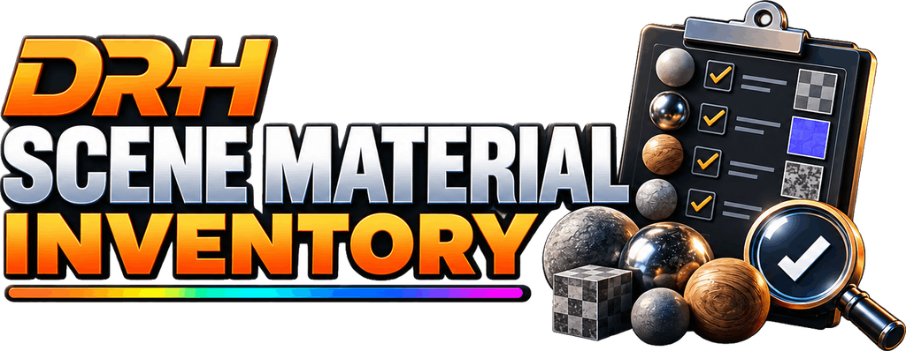
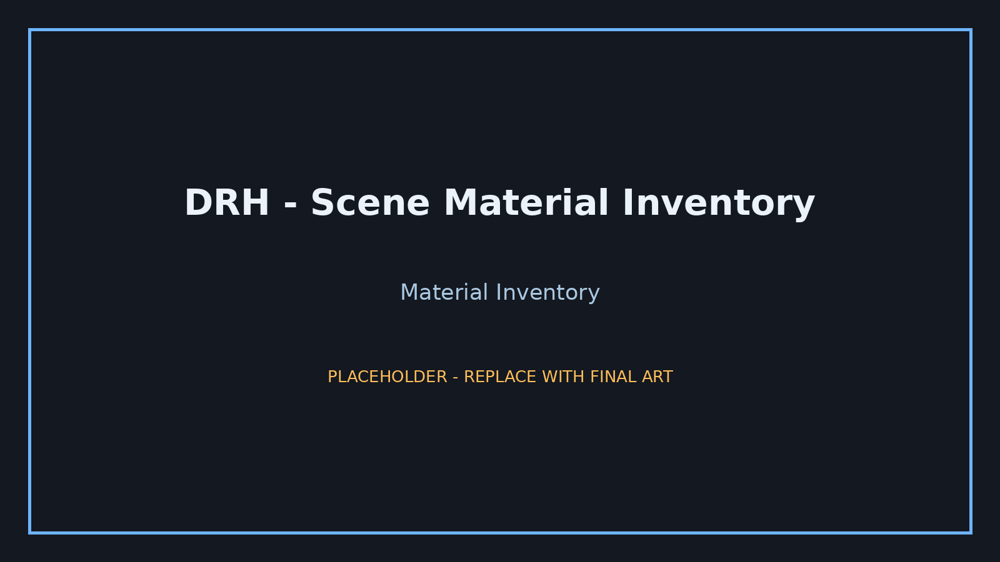

# DRH - Scene Material Inventory

**Before you send the .blend, know every material, texture, and missing file inside it.**

   

  

## The wall

A scene you built over three weeks. Forty materials, ninety images, half of them packed, two with paths pointing at a folder that moved. You export, the other artist opens it, and the shirt is pink.

Scene Material Inventory reads the scene and writes down what's there. Which materials exist, how many objects and slots use them, which node trees are reachable, what images they reference, whether those files resolve, and what the PBR maps look like. Then it hands you a report you can actually send.

## What the report covers

**Materials and where they're used.** Material names, datablock users, material-slot references, and object counts, so an unused material with 12 textures behind it stops being invisible.

**Shader internals.** Reachable node trees, shader types, node counts, nested groups, and Principled BSDF usage.

**Images.** Source type, resolution, packing state, alpha use, file size, and whether the file is missing.

**PBR maps.** Common map roles, the shader they feed, naming fallback for files that don't follow your convention, packed-map conventions, and color-space hints worth checking.

**Collections.** Optional per-collection material usage, useful when the scene is really six scenes pretending to be one.

Output goes to searchable HTML, a structured XLSX workbook, or CSV. Path sanitization is on by default, so a report you forward doesn't carry your local user directory with it. Report options can be saved as defaults and reapplied to other scenes.

## Who it's for

Freelancers handing files to clients. Studio artists inheriting someone else's scene. Pipeline and asset managers who need a list instead of a screenshot. Anyone who has ever said "it worked on my machine."

## Get it

Free on BlendKit, Blender 4.2 or newer. Pairs with [Color Ramp Studio](https://github.com/pacosalasv/DRH_Color_Ramp_Studio-Support) when the audit turns up ramps that need rebuilding.

Bugs and requests: [open an issue](https://github.com/pacosalasv/DRH_Scene_Material_Inventory-Support/issues)

  

